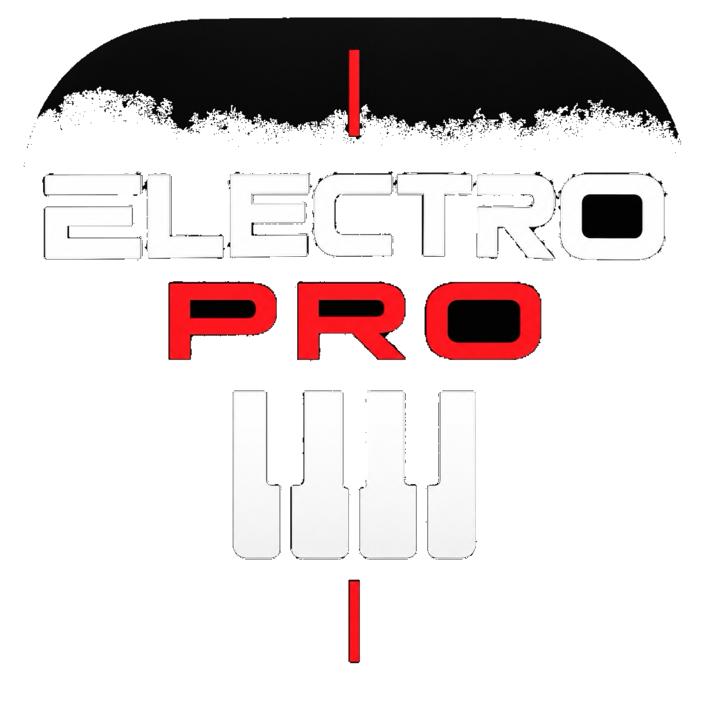
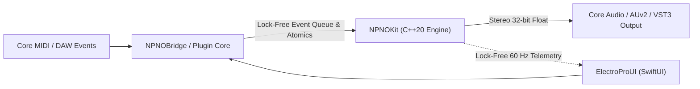

<div align="center">
  
  <h1>Electro Pro</h1>
  <p><strong>Native macOS multitimbral virtual piano &amp; sample workstation for <code>.npno</code> and <code>.nsmp4</code> libraries.</strong></p>
  <p>
    
    
    
    
    
  </p>
</div>

---

## Overview

**Electro Pro** is a native macOS multitimbral virtual instrument and sample workstation designed to decode and play legally obtained Nord Piano Library (`.npno`) and Nord Sample Library 4 (`.nsmp4`) files directly on macOS—available as a **Standalone macOS app**, an **AudioUnit v2 (`.component`)** plugin, and a **VST3 (`.vst3`)** plugin.

Its synthesis core (`NPNOKit`) is written in real-time-safe **C++20** with zero allocations and zero blocking locks on the audio thread, paired with a unified **SwiftUI** Liquid Glass workstation interface shared across the standalone app and DAW plugins.

---

## Key Features

### Lock-Free C++20 Audio Engine (`NPNOKit`)
- **Real-time safe render path:** Strictly lock-free MPSC event queue (`2048` slots), try-lock parameter snapshots, one-pole `~10 ms` parameter smoothing, and zero heap allocations in `Engine::render`.
- **High-fidelity resampling:** 4-point cubic Hermite interpolation converting native `34,990 Hz` LPC-decoded audio to host output rates (`44.1 kHz`, `48 kHz`, etc.).
- **High-density polyphony:** Configurable up to **512 voices** with strict priority-tiered voice stealing (`killing < releaseVoice < releasing < sustained < held/sostenuto`) and anti-click fade ramps.
- **On-demand RAM management:** Optional *Purge Unused Samples* keeps `4096`-frame attack prefixes resident for instant playback while freeing unused memory, with reload support.

### 4-Layer Multitimbral Workstation (Layers A–D)
- **Independent layer routing:** Key range (`keyLow`–`keyHigh`), velocity range (`velLow`–`velHigh`), octave shift (`-3` to `+3`), per-layer MIDI channel, and mono legato / portamento.
- **Velocity & timbre shaping:** 6 per-layer velocity curves (*Main*, *Soft*, *Linear*, *Hard*, *Exp*, *Log*), global touch curve (*Light*, *Normal*, *Heavy*), and 5 timbre voicings (*Mid*, *Bright*, *Soft*, *Dyno 1*, *Dyno 2*).
- **Per-layer processing:** 1-pole low-pass filter (`140 Hz – 20 kHz`), compressor with fast attack toggle, configurable attack/release or original sample envelope, and stereo chorus/ambience (`FXA`).

### Authentic Acoustic & Pedal Behavior
- **Release & damper modeling:** Velocity-scaled key-release damper samples and undamped upper register support (`damperBoundary`).
- **Complete MIDI pedal support:** Continuous `CC64` half-pedaling (`>= 64` full sustain, `20–63` gradual damping), syncopated re-pedaling (*damper catch*), `CC66` sostenuto, `CC67` una corda, `CC11` expression, and `CC7` channel volume.
- **Channel-isolated & MIDI 1.0 compliant:** Per-channel sustain tracking and spec-compliant `CC123` (*All Notes Off*, preserving sustained notes) vs. `CC120` (*All Sound Off*).

### Master Studio Effects Chain
- **3-Band Equalizer:** Low shelf (`110 Hz`), sweepable mid peaking EQ (`150 Hz – 8 kHz`), and high shelf (`4 kHz`).
- **Harmonic Drive & Dual Modulators:** Asymmetric tube/tape saturation and two independent modulators targeting Volume (Tremolo), Filter (Auto-Wah), Pitch (Vibrato), or Pan (Auto-Pan) with 5 waveforms including Envelope Follower.
- **Stereo Delay & Reverb:** Ping-pong / stereo delay with host BPM sync divisions and tap tempo, Schroeder/Freeverb-style stereo reverb, plus a zero-lookahead transparent master limiter (`-0.3 dBFS` ceiling).

### Unified Workstation UI & Workflow
- **Shared SwiftUI UI:** Runs natively in the Standalone app (`ElectroPiano`) and inside the `AudioUnit` and `VST3` bundles via `PluginHosting.swift`.
- **Program Management:** 4 quick-recall program slots, Undo/Redo with drag coalescing, modified indicator, autosave, and `.epprog` JSON import/export.
- **MIDI & Audio Diagnostics:** Right-click MIDI Learn, Mapping Manager, 30 Hz lock-free MIDI Monitor, 60 Hz peak/clip meters, automatic Core Audio route/sample-rate recovery, and Core MIDI hot-plug support.

---

## Architecture



### Repository Structure

| Path | Description |
| :--- | :--- |
| [`Sources/NPNOKit`](Sources/NPNOKit) | C++20 `.npno`/`.nsmp4` container parser, LPC decoder, `Instrument` loader, and real-time `Engine` |
| [`Sources/NPNOBridge`](Sources/NPNOBridge) | C ABI bridge, Core Audio HAL output host, Core MIDI input/hot-plug, and offline test helpers |
| [`Sources/ElectroProUI`](Sources/ElectroProUI) | Shared SwiftUI Liquid Glass workstation UI, ViewModel, localized `.xcstrings`, and plugin view hosting |
| [`Sources/ElectroPianoApp`](Sources/ElectroPianoApp) | Standalone macOS application entry point and menu commands |
| [`Sources/ElectroPianoPlugin`](Sources/ElectroPianoPlugin) | Objective-C++ AudioUnit v2 (`aumu`/`Epno`) and VST3 (`PluginShared`, `AudioUnitPlugin`, `VST3Plugin`) targets |
| [`Sources/npno-cli`](Sources/npno-cli) | Read-only CLI for inspecting, validating, exporting WAVs, and offline rendering `.npno`/`.nsmp4` files |
| [`Tests/ElectroPianoTests`](Tests/ElectroPianoTests) | Swift Testing suite for serialization, velocity curves, zones, pedals, CC123/CC120, and voice stealing |
| [`docs/NPNO_FORMAT.md`](docs/NPNO_FORMAT.md) | Technical binary format specification for `.npno` and `.nsmp4` containers |
| [`scripts/`](scripts) | Build, signing, and packaging scripts for macOS plugins/installers (`build_plugins.sh`, `build_installer_mac.sh`) |

---

## Building & Testing

### Prerequisites
- **macOS 26.0+** (Apple Silicon `arm64`)
- **Xcode / Swift 6.2** toolchain with Clang C++20 support

### Build Standalone App & CLI
```bash
swift build -c release
```

### Run Unit Tests
```bash
swift test
```

### Build & Install AudioUnit (`.component`) and VST3 (`.vst3`) Plugins
```bash
bash scripts/build_plugins.sh
```
This compiles the Release objects, bundles `Electro Piano.component` and `Electro Piano.vst3`, ad-hoc codesigns them, installs them to `~/Library/Audio/Plug-Ins/Components/` and `~/Library/Audio/Plug-Ins/VST3/`, and refreshes `AudioComponentRegistrar`.

### Inspect or Validate Sample Banks with `npno-cli`
```bash
swift run npno-cli info "/path/to/Piano.npno"
swift run npno-cli validate "/path/to/Piano.npno"
swift run npno-cli records "/path/to/Piano.npno" 60
swift run npno-cli export "/path/to/Piano.npno" 0 sample.wav
swift run npno-cli render "/path/to/Piano.npno" demo_render.wav
```

---

## Documentation & Legal Notice

- Technical format notes: [`docs/NPNO_FORMAT.md`](docs/NPNO_FORMAT.md)
- **Disclaimer:** Electro Pro is an independent software project intended solely for loading and playing legally obtained `.npno` and `.nsmp4` sample files without proprietary DRM circumvention. No proprietary sample libraries are included in this repository. Electro Pro is not affiliated with, sponsored by, or endorsed by Clavia Digital Musical Instruments AB (Nord).
